### Oi 👋

Sou o Guilherme, analista desenvolvedor .NET. Trabalho com manutenção e evolução de sistemas em arquitetura de microsserviços, sempre atrás de código rápido, escalável e de qualidade.

- 🧱 Dia a dia: C#, .NET, Entity Framework, SQL Server e Oracle
- 🖥️ Também mexo com React e Angular
- 🐳 Docker, Kubernetes, Azure DevOps e RabbitMQ no deploy e na integração
